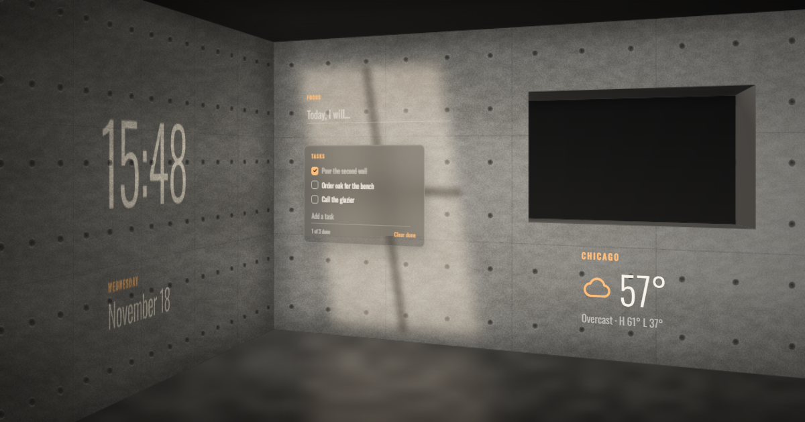
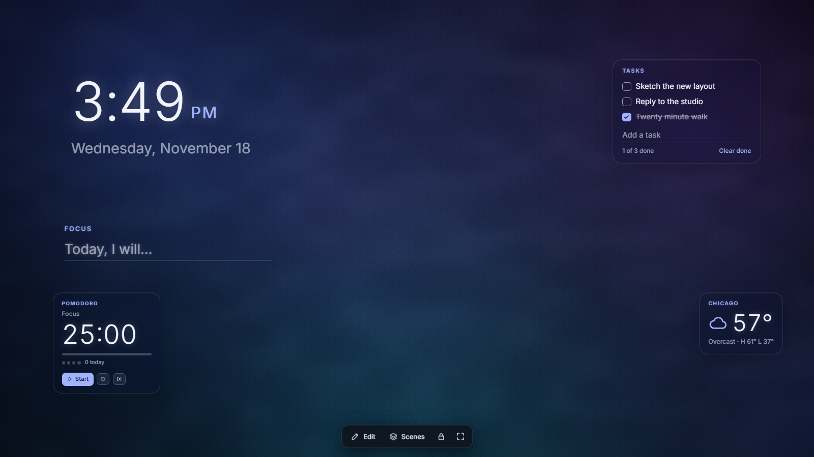
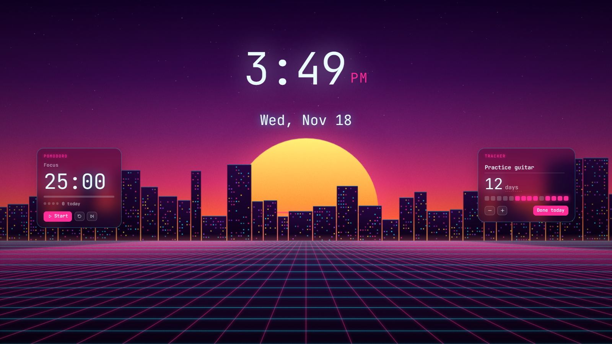
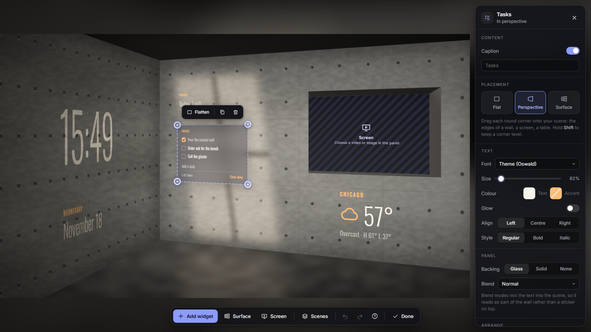
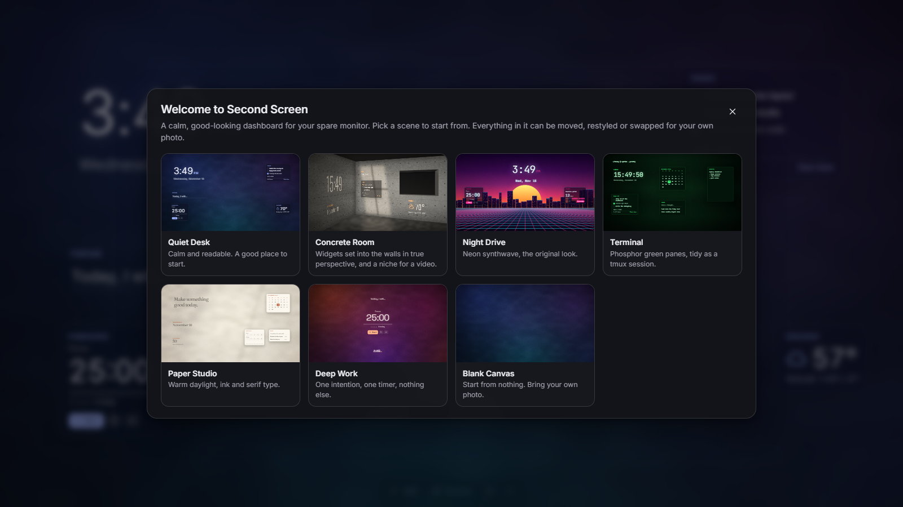

# Second Screen

An ambient dashboard for your spare monitor. Clocks, timers, tasks and notes that sit *in* a scene instead of floating on top of it: a clock painted onto a concrete wall, a video playing through a niche in a photo, a task list mounted on a panel in true perspective.



It is a static web page: no build step, no account, no server. Open it, pick a scene, and leave it running full screen.

## What you can do

- **Start from a scene.** Seven starter scenes (Quiet Desk, Concrete Room, Night Drive, Terminal, Paper Studio, Deep Work, Blank Canvas), each laid out for landscape, portrait and ultrawide screens.
- **Pin widgets into perspective.** Select any widget, choose *Perspective*, and drag its four corners onto a wall, a screen or a desk in your background. Blend modes make text read as printed or painted onto the surface.
- **Draw surfaces.** Click the four corners of a flat surface in your photo to make a perspective grid. Widgets dropped on it snap into its cells.
- **Trace screens.** Click around an opening in your picture and play a YouTube video, a video file or an image through it. Four corners give true perspective.
- **Use your own background.** Upload a photo, paste an image link, or set a YouTube video as a moving background.
- **16 widgets:** clock (any time zone), date, calendar, weather, countdown, text, focus, tasks, notes, Pomodoro, goal, tracker, capture, wins, mood and energy check-in.
- **12 themes**, from calm Midnight to neon Night Drive to daylight Paper.
- **Share a layout as a link.** Links carry the scene and arrangement but leave out your notes, tasks and logs. Backup files carry everything.
- **Privacy shade.** Press `P` to slide a frosted pane over the screen.

| | |
|---|---|
|  |  |
|  |  |

## How it works

**View and edit are separate.** The dashboard opens clean. Controls appear when you move the mouse and fade when you stop. Press `E` (or *Edit*) to arrange things: a dock at the bottom holds the tools, and one inspector on the right changes with whatever you select.

| Key | Does |
|---|---|
| `E` | Edit, or finish editing |
| `A` | Add a widget |
| `G` | Draw a surface |
| `S` | Trace a screen |
| `P` | Privacy shade |
| `F` | Full screen |
| `I` | Show or hide the inspector |
| `?` | Help |
| `Ctrl/Cmd Z` | Undo (add Shift to redo) |
| `Ctrl/Cmd D`, `C`, `V` | Duplicate, copy, paste |
| Arrows | Nudge (Shift for 10px) |

Holding `Alt` while dragging turns off snapping. Holding `Shift` on a perspective corner keeps it level. Double-clicking a pinned widget flattens it.

## Running it

Open `index.html` in a browser. Everything works from a file except YouTube, which refuses to embed on pages with no web origin (its error 153). To use YouTube locally, serve the folder:

```
python -m http.server 8000
# then open http://localhost:8000
```

Or use the hosted copy.

### Deploying

Any static host works, since there is nothing to build.

- **Render:** the repo includes a `render.yaml` blueprint. In Render choose *New → Blueprint*, pick this repository, and it deploys as a static site.
- **GitHub Pages:** serve from the `main` branch root.

## How it is built

Plain HTML, CSS and JavaScript, with no framework or dependencies. Fonts load from Google Fonts and fall back to system fonts offline. Weather comes from [Open-Meteo](https://open-meteo.com), which needs no API key.

| File | Role |
|---|---|
| `js/geometry.js` | Homography maths behind the corner-pin warp (`matrix3d`) |
| `js/scenes.js` | Themes, fonts, and the code-drawn scenes, including the perspective room |
| `js/store.js` | Saving to `localStorage`, media in IndexedDB, share links, migration from v1 |
| `js/widgets.js` | The widget library. Each widget declares its inspector options |
| `js/templates.js` | Starter scenes, with portrait arrangements |
| `js/app.js` | Rendering, selection, every drag interaction, the inspector, history |

Things worth knowing before changing the code:

- **Two coordinate spaces.** Layouts are authored on a fixed canvas ("board" space) and scaled to fit the screen. Pointer handlers convert with `toBoard()`. Handles and outlines are drawn in screen space with `toScreen()`, so they stay the same size at any zoom.
- **Pinned widgets keep a base size.** A pinned widget stores its four corners (`pin`) and the content size they were set against (`pinBase`), so content that grows, such as a longer task list, carries on down the same plane.
- **Media never lives in the layout.** Uploaded images and videos go into IndexedDB and are referenced as `idb:…`. That keeps the layout small and lets local video files survive a reload.
- **Players are cached.** A screen only rebuilds its video or iframe when its source changes, so dragging never restarts playback.
- **Drags listen on `document`** and clean up in a `finally`, so a failed pointer capture can't strand a drag.

### Tests

Open `index.html?test=1&canvas=1600x900`. A self-test runs in the page and prints results in the corner. It covers the geometry, every template at landscape, portrait and ultrawide sizes, every widget type, and real pointer and keyboard input: dragging, resizing, pinning corners, drawing a surface and snapping into it, marquee selection, undo and redo, share links, and v1 migration.

## Privacy

Everything stays in your browser. Nothing is sent anywhere except requests you trigger: weather lookups to Open-Meteo for the city you enter, YouTube embeds you add, and Google Fonts.
